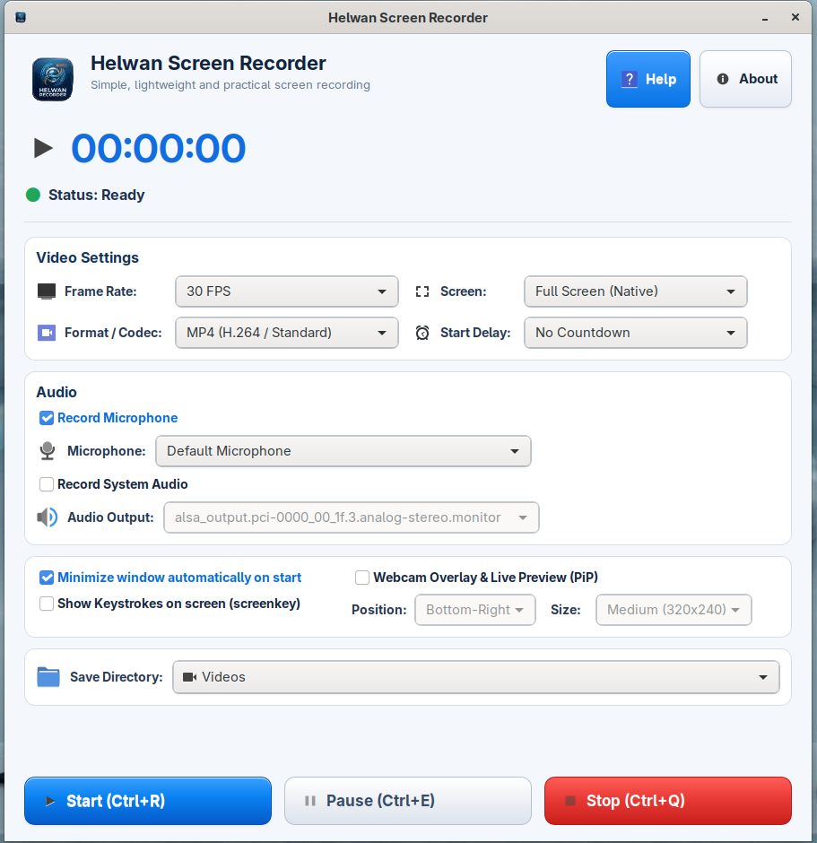

<div align="center">



# Helwan Screen Recorder

**A simple, lightweight, and practical screen and audio recorder for Linux/X11.**

</div>

Helwan Screen Recorder (HSR) is a GTK3 desktop application written in **Go** for recording the desktop, microphone, system audio, and webcam on **Linux/X11**.

It is built around a simple idea:

> **Press Record. Capture what you need. Pause when you want. Save a clean recording.**

HSR uses **FFmpeg** for capture, encoding, audio processing, and finalization while keeping the interface focused on practical recording work.

## Current Status

**Package version: 1.3.0-2**

The current implementation has moved well beyond basic screen capture. It now includes a complete recording workflow with separate video/audio pipelines, hardware-encoder probing, segment-based Pause/Resume, crash-recovery support, webcam PiP, mouse effects, keystroke display, screenshots, recording OSD, global X11 shortcuts, automatic stop, and low-disk-space protection.

The project is currently **Linux/X11 focused**. Wayland is not the target of the present capture architecture.

## Features

### Screen Recording

- Full-screen X11 recording.
- Monitor selection.
- Window selection through `slop`.
- Custom recording-area selection through `slop`.
- 30 FPS or 60 FPS.
- Automatic desktop-resolution detection through `xrandr`.
- `xdpyinfo` fallback for native resolution detection.
- Validation of the selected recording dimensions.
- Optional mouse-cursor capture.
- FFmpeg `x11grab` capture.

### Audio Recording

- Microphone recording.
- System-audio recording.
- Microphone + system audio simultaneously.
- Microphone source selection.
- System-audio monitor-source selection.
- PulseAudio-compatible source discovery through `pactl`.
- Microphone mute detection.
- Optional microphone unmute before recording.
- Independent microphone and system-audio inputs.
- Mixed audio mode.
- Separate microphone/system-audio tracks.
- Independent microphone volume.
- Independent system-audio volume.
- Optional microphone noise reduction when FFmpeg provides `afftdn`.
- AAC audio for MP4/MKV.
- Opus audio for WebM.
- 192 kbps audio encoding.

### Audio Architecture

When audio is enabled, video and audio are recorded by separate FFmpeg processes:

```text
X11 Screen ───────────────► FFmpeg Video
                                  │
                                  ▼
                           Video Part

Microphone ────────┐
                   ├────────────► FFmpeg Audio
System Audio ──────┘
                                  │
                                  ▼
                           Audio Part
```

This keeps the video capture path independent from PulseAudio processing and audio filters.

When both sources are enabled, HSR can mix them with FFmpeg `amix`. When separate-track mode is selected, microphone and system audio remain separate streams for later editing.

The application also checks whether the installed FFmpeg supports `-thread_queue_size` before adding that option to capture commands.

### Hardware Acceleration

HSR probes hardware encoders before using them instead of assuming that a GPU encoder is available.

The selection order is:

```text
VAAPI
  │
  └── Intel / AMD

NVENC
  │
  └── NVIDIA

CPU
  │
  └── libx264 fallback
```

#### VAAPI

The recorder searches for usable DRM render devices under:

```text
/dev/dri/renderD*
```

Each candidate is tested with FFmpeg. When successful, `h264_vaapi` is selected.

HSR also tests the required pixel-format conversion path and can use GPU-side conversion when supported.

#### NVENC

On NVIDIA systems, HSR checks for NVIDIA device support and performs an actual `h264_nvenc` encoding test before selecting it.

#### CPU fallback

If no working hardware encoder is available, HSR automatically uses `libx264` with a low-latency configuration.

### Quality and Bitrate

The Advanced panel provides:

- **High** — better quality, larger files.
- **Standard** — recommended default.
- **Small** — smaller files, lower quality.

Fixed bitrate options:

- Auto
- 2 Mbps
- 4 Mbps
- 8 Mbps
- 12 Mbps
- 20 Mbps

A fixed bitrate overrides the quality-level setting.

### Recording Formats

#### MP4

- H.264 video.
- AAC audio.
- `+faststart` finalization.
- Suitable for general playback and sharing.

#### MKV

- H.264 video.
- AAC audio.
- Recorded through the safer Matroska intermediate path.

#### WebM

- VP9 video.
- Opus audio.
- Realtime-oriented VP9 settings.
- Suitable for web-oriented recordings.

#### Animated GIF

- 15 FPS.
- Maximum output width of 720 pixels.
- Automatic palette generation.
- Palette-based conversion.
- Audio disabled.
- Intended for short clips.

## Safe Recording Parts

HSR deliberately does not write MP4 directly while recording.

MP4 and GIF sessions are recorded into temporary Matroska parts, while WebM sessions use WebM parts.

Example:

```text
.hel_rec_part_123456789.mkv
```

The temporary parts are stored beside the final recording rather than relying on `/tmp`. This reduces the risk of filling a RAM-backed `/tmp` filesystem and makes final file movement faster when the destination filesystem is unchanged.

For MP4 finalization, HSR uses stream-copy remuxing:

```text
-c copy
-movflags +faststart
```

The captured video is therefore not unnecessarily re-encoded during MP4 finalization.

If finalization fails, the raw recording is retained as an MKV fallback instead of silently discarding the captured footage.

## Pause & Resume

HSR uses a **segment-based Pause/Resume system**.

When recording is paused:

1. The current video FFmpeg process is cleanly closed.
2. The current video part is preserved.
3. The current audio part is preserved when audio is enabled.
4. Audio input is stopped cleanly.
5. Recording enters the paused state.
6. Resume starts a new recording segment.
7. Multiple segments can be created during one session.
8. The segments are merged automatically when recording finishes.

The final result is presented as one recording.

This approach avoids relying on a fragile in-process FFmpeg pause mechanism.

## Crash / Power-Loss Recovery

HSR keeps unfinished recording parts so that an interrupted recording can be recovered after an unexpected shutdown or crash.

At startup, the recovery system can detect orphaned recording parts and offer recovery actions such as:

```text
Recover
Delete
Later
```

Recovery logic can:

- Scan for unfinished recording parts.
- Pair matching video/audio parts.
- Recover video-only recordings when possible.
- Recover audio-only material when possible.
- Mux recovered video and audio when possible.
- Preserve usable footage if audio recovery fails.
- Avoid overwriting an existing recovered filename.

The recovery logic is covered by dedicated Go tests.

## Webcam Overlay

HSR supports a webcam **Picture-in-Picture (PiP)** overlay.

Enable:

```text
Webcam Overlay (PiP)
```

The webcam is composited into the recorded video itself.

Available sizes:

- 240 × 180
- 320 × 240
- 480 × 360

Available positions:

- Bottom-Right
- Bottom-Left
- Top-Right
- Top-Left

The recorder detects usable V4L2 webcam devices under:

```text
/dev/video*
```

If the webcam supports MJPEG, HSR can use MJPEG input to reduce unnecessary camera-side processing.

The webcam is part of the recorded video; it is not a separate floating desktop window.

## Mouse Cursor & Mouse Effects

HSR can capture the normal mouse cursor.

It also provides optional **Mouse Click Effects**.

When enabled, the recorder uses a transparent X11 overlay to show:

- A cursor halo.
- A visible click ring when a mouse button is pressed.

Toggle:

```text
Ctrl + T
```

The mouse-effects checkbox remains synchronized with the real effect state.

Mouse effects require a composited X11 desktop with support for transparent RGBA windows.

## Keystroke Display

Optional on-screen keyboard visualization is provided through **Screenkey**.

Enable:

```text
Show Keystrokes on screen
```

Useful for:

- Tutorials.
- Programming videos.
- Software demonstrations.
- Linux tutorials.
- Educational recordings.
- Keyboard-driven workflows.

Screenkey is started only when the feature is enabled for the recording.

## Floating Recording OSD

During recording, HSR provides a floating status control.

Example:

```text
🔴 REC 00:12:34   ⏸   ⏹
```

While paused:

```text
⏸ PAUSED 00:12:34
```

The OSD provides quick access to:

- Pause / Resume.
- Stop.

Its position is remembered for later recording sessions.

## System Tray

HSR provides system-tray controls when supported by the desktop environment.

The tray can provide:

- Show Window.
- Start Recording.
- Pause / Resume.
- Stop and Save.
- Quit.

The implementation supports traditional GTK status icons and compatible AppIndicator libraries when available.

## Screenshot

HSR includes a screenshot function in the main interface.

The screenshot workflow supports:

- Full screen.
- Selected area.
- Selected window.
- Selected monitor.

Screenshots are saved as PNG files with timestamped names such as:

```text
Screenshot_2026-11-27_09-30-15.png
```

## Countdown

Recording can start after an optional countdown:

- No Countdown.
- 3 seconds.
- 5 seconds.
- 10 seconds.

The countdown appears in a large on-screen window and can be cancelled before recording starts.

## Automatic Minimize

HSR can automatically minimize its main window when recording starts.

This keeps the recorder interface out of the captured desktop.

The main window is restored when recording finishes.

## Automatic Stop

The Advanced panel provides optional recording limits:

- No limit.
- 5 minutes.
- 10 minutes.
- 15 minutes.
- 30 minutes.
- 1 hour.
- 2 hours.

When the selected limit is reached, HSR follows the normal stop-and-save workflow.

## Low-Disk-Space Protection

HSR can monitor available disk space during recording.

Available settings:

- Off.
- Keep 500 MB free.
- Keep 1 GB free.
- Keep 2 GB free.
- Keep 5 GB free.

The disk guard considers the free-space margin together with the space already occupied by the recording because finalization can require additional temporary space.

When available space becomes too low, HSR automatically stops through the normal save workflow instead of continuing until the filesystem is full.

The default setting is:

```text
Keep 1 GB free
```

## Global Keyboard Shortcuts

HSR provides global X11 keyboard shortcuts:

| Shortcut | Action |
|---|---|
| `Ctrl + R` | Start recording |
| `Ctrl + E` | Pause / Resume |
| `Ctrl + Q` | Stop and save |
| `Ctrl + G` | Toggle KMag |
| `Ctrl + T` | Toggle Mouse Effects |

The shortcuts work outside the main application window.

The X11 hotkey implementation accounts for:

- Caps Lock.
- Num Lock.
- Different keyboard layouts.

## Magnifier

`Ctrl + G` launches or closes **KMag**.

This is useful for demonstrations involving small UI elements, settings, terminal commands, accessibility features, or detailed interface operations.

KMag remains an external application rather than being embedded into HSR.

## Recording Workflow

A typical session looks like this:

```text
Launch Helwan Screen Recorder
          │
          ▼
Select screen / monitor / area / window
          │
          ▼
Select FPS
          │
          ▼
Select video format
          │
          ▼
Select quality / bitrate
          │
          ▼
Select microphone / system audio
          │
          ▼
Optional volume / denoise / separate tracks
          │
          ▼
Optional webcam / keystrokes / cursor / mouse effects
          │
          ▼
Optional countdown
          │
          ▼
       RECORD
          │
          ├───────────────┐
          │               │
          ▼               ▼
       PAUSE           CONTINUE
          │
          ▼
       RESUME
          │
          ▼
        STOP
          │
          ▼
Merge recording parts
          │
          ▼
Finalize output
          │
          ▼
      Save recording
```

## Requirements

HSR is designed for:

```text
Linux + X11
```

Runtime dependencies used by the current package are:

- FFmpeg.
- GTK3.
- libpulse.
- libX11.
- KMag.
- `slop`.
- Screenkey.

For webcam overlay, FFmpeg must provide V4L2 support and a compatible webcam must be available under `/dev/video*`.

For the Arch Linux / Helwan Linux package, the dependencies are declared in `PKGBUILD`.

Install the runtime dependencies on an Arch-based system with:

```bash
sudo pacman -S ffmpeg gtk3 libpulse libx11 kmag slop screenkey
```

## Building From Source

### Build requirements

- Go 1.22 or newer.
- GTK3 development libraries.
- X11 development libraries.
- FFmpeg.
- PulseAudio development/runtime support.
- A working CGO toolchain.

The Go module currently uses:

```text
github.com/gotk3/gotk3 v0.6.2
```

Clone the repository:

```bash
git clone https://github.com/helwan-linux/hel-recorder.git
cd hel-recorder/hel-recorder
```

Build:

```bash
go build -o hel-recorder .
```

Run:

```bash
./hel-recorder
```

## Testing

The project includes unit tests for audio-filter construction and recovery logic.

Run:

```bash
go test ./...
```

The Arch package build also runs the test suite during `makepkg`'s `check()` stage.

## Debug Mode

For troubleshooting FFmpeg and recording behavior:

```bash
HSR_DEBUG=1 ./hel-recorder
```

Debug output can report information such as:

- Hardware-encoder detection.
- FFmpeg capability checks.
- FFmpeg command construction/execution.
- Input queue support.
- Recording pipeline events.
- Recovery activity.

## Force CPU Encoding

For testing or troubleshooting hardware acceleration:

```bash
HSR_FORCE_CPU=1 ./hel-recorder
```

This bypasses automatic hardware encoder selection and uses the CPU encoder.

## Audio Synchronization Testing

For systems that need an audio synchronization adjustment:

```bash
HSR_AUDIO_OFFSET_MS=50 ./hel-recorder
```

Positive values delay audio; negative values move audio earlier.

This is an advanced troubleshooting control and is normally unnecessary.

## Arch Linux Package

The repository includes a `PKGBUILD` for Arch-based systems.

Build and install:

```bash
makepkg -si
```

The package installs:

```text
/usr/bin/hel-recorder
```

Application icons are installed under:

```text
/usr/share/icons/hicolor/128x128/apps/
/usr/share/icons/hicolor/256x256/apps/
```

The GTK3 stylesheet is installed as:

```text
/usr/share/helwan-screen-recorder/style.css
```

The desktop entry is installed as:

```text
/usr/share/applications/helwan-screen-recorder.desktop
```

Package metadata:

```text
pkgname = hsr
pkgver  = 1.3.0
pkgrel  = 2
arch    = x86_64
```

## Output Files

Recordings use timestamped filenames such as:

```text
Recording_2026-11-27_09-30-15.mp4
```

The default save directory is the user's `~/Videos` directory when it exists; otherwise the user's home directory is used.

Temporary recording parts are removed after successful finalization.

If a recording is interrupted unexpectedly, the unfinished parts can be detected by the recovery system on the next launch.

## Project Structure

```text
hel-recorder/
├── assets/
│   └── icon.png
├── audio_filters.go
├── audio_filters_test.go
├── camera.go
├── config.go
├── extras.go
├── features.go
├── formats.go
├── go.mod
├── go.sum
├── hel-recorder.desktop
├── main.go
├── monitors.go
├── mouse_effects.go
├── options.go
├── recorder.go
├── recovery.go
├── recovery_logic.go
├── recovery_logic_test.go
├── style.css
├── tray.go
├── ui.go
└── x11_hotkeys.go
```

### Main Components

`main.go`

Initializes GTK, the recorder manager, global shortcuts, tray integration, screenshot handling, recovery handling, and application shutdown.

`ui.go`

Contains the GTK3 interface, recording controls, video settings, audio settings, Advanced settings, webcam controls, screenshot control, Help, and About.

`recorder.go`

Contains the main recording lifecycle, FFmpeg process management, separate video/audio pipelines, Pause/Resume, recording parts, hardware encoder integration, automatic stop, and disk protection.

`formats.go`

Contains format selection, hardware-encoder probing, encoder settings, recording-container selection, recording-part merging, MP4 remuxing, GIF conversion, and finalization.

`audio_filters.go`

Contains microphone/system-audio filters, volume handling, optional denoise, mixing, and separate-track generation.

`options.go`

Contains quality, bitrate, automatic-stop, disk-space protection, and related recording options.

`camera.go`

Contains webcam detection, V4L2/MJPEG capability handling, and webcam overlay settings.

`features.go`

Contains optional runtime features such as the floating recording OSD, countdown, Screenkey integration, and KMag integration.

`extras.go`

Contains auxiliary features including screenshot handling and UI synchronization for optional recording effects.

`mouse_effects.go`

Contains the transparent X11 mouse-effects overlay and click animations.

`recovery.go`

Handles startup detection and user interaction for unfinished recordings.

`recovery_logic.go`

Contains the recovery logic for discovering, pairing, recovering, and deleting unfinished recording parts.

`tray.go`

Provides system-tray integration.

`monitors.go`

Handles monitor detection and monitor selection.

`x11_hotkeys.go`

Provides global X11 keyboard shortcuts.

`config.go`

Handles persistent recorder configuration.

## Design Goals

### Simple

Keep the important recording controls visible without turning HSR into a complicated production suite.

### Practical

Prioritize features that are useful during real desktop-recording sessions.

### Lightweight

Use Go and GTK3 for the application while delegating media capture and processing to FFmpeg.

### Reliable

Validate important dependencies, capture parameters, hardware encoders, audio sources, and disk space instead of assuming they are available.

Preserve intermediate recording parts and provide recovery after unexpected interruption.

### Linux-Focused

Use native Linux technologies where they make sense:

- X11.
- FFmpeg.
- PulseAudio-compatible `pactl`.
- V4L2.
- VAAPI.
- NVENC.
- GTK3.

## What HSR Is Not

Helwan Screen Recorder is not intended to reproduce every feature of large production-oriented recording suites.

Its focus is a clean, practical desktop-recording workflow:

- Screen capture.
- Microphone and system audio.
- Webcam PiP.
- Pause / Resume.
- Multiple output formats.
- Hardware acceleration.
- Audio mixing and separate tracks.
- Mouse effects.
- Keystroke display.
- Recording OSD.
- Screenshots.
- Global shortcuts.
- Automatic stopping.
- Disk-space protection.
- Crash recovery.

The goal is to keep the application understandable while covering the features that matter during everyday recording.

## License

Helwan Screen Recorder is released under the **MIT License**.

## Project

Helwan Screen Recorder is part of the **Helwan Linux** project.

> **A practical recorder should be easy to use, reliable when recording matters, and fast enough to stay out of the way.**
